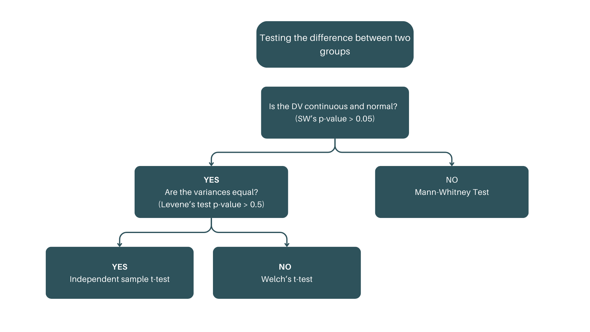
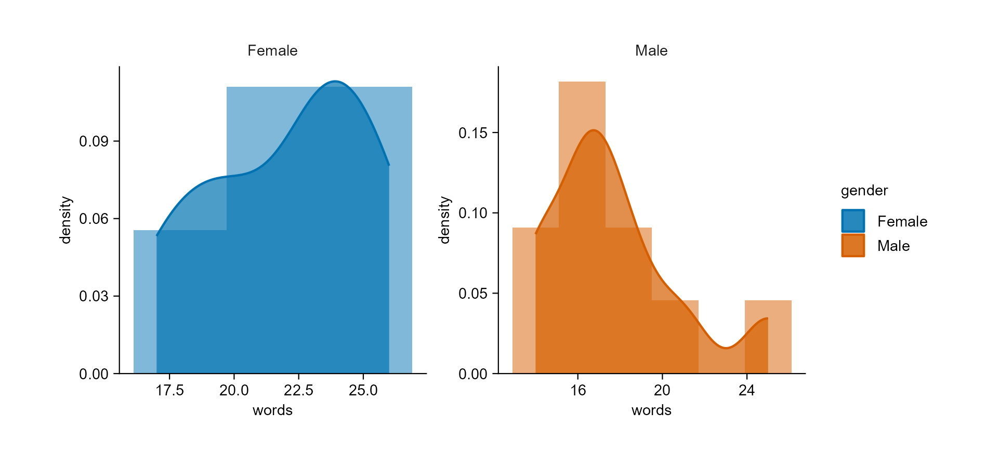
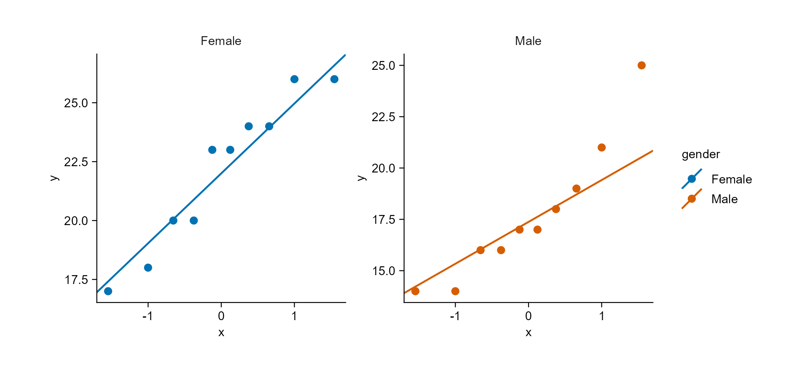
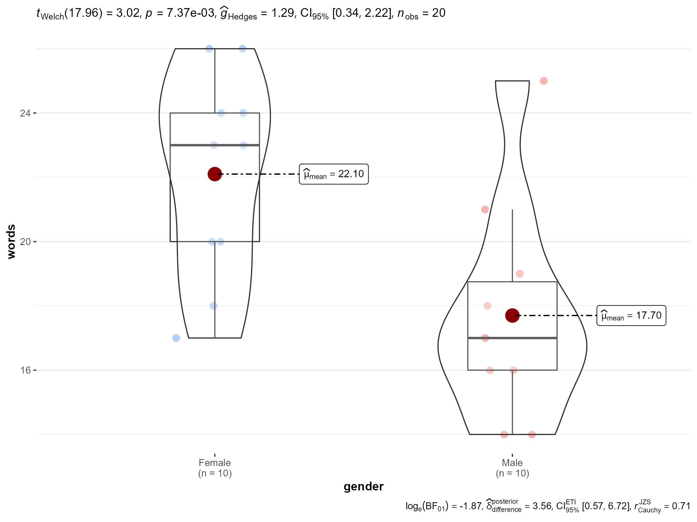
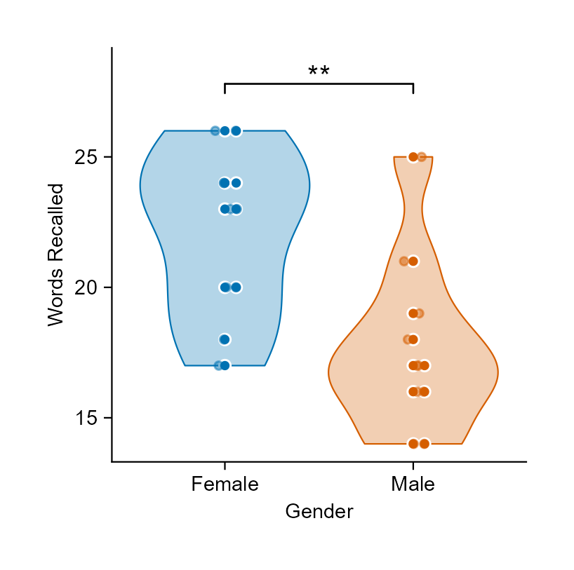
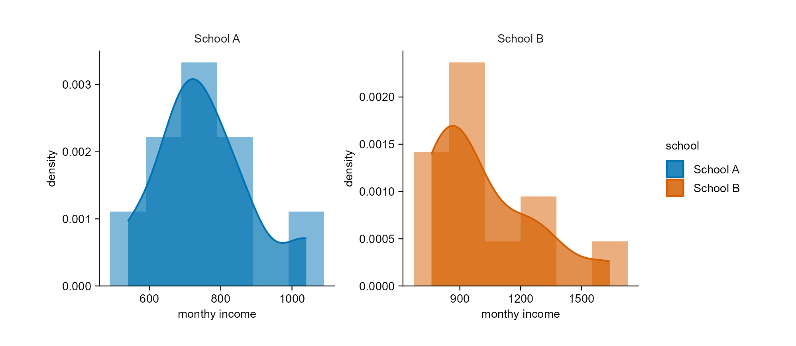
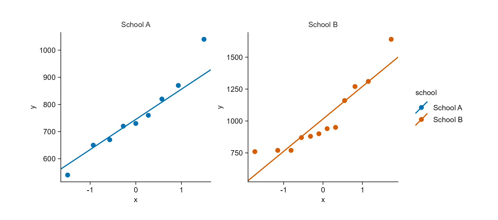
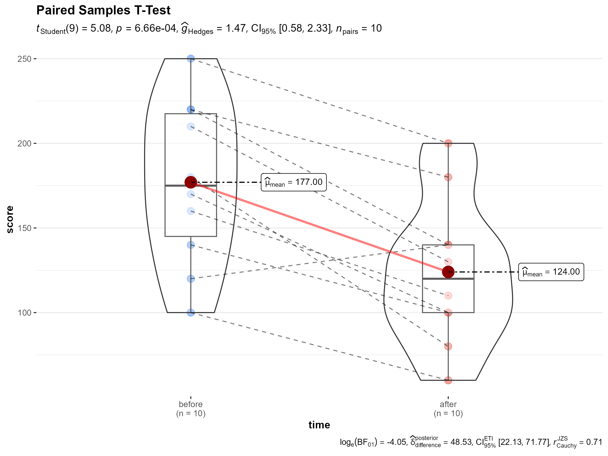
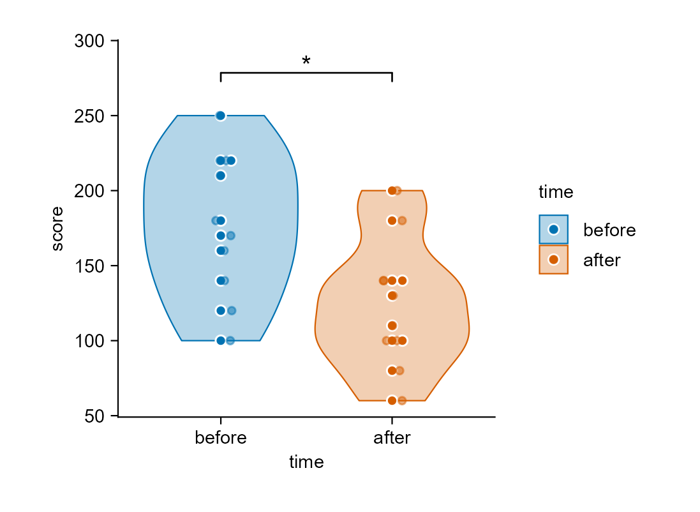

```{r}
#| echo: false
#| include: false

knitr::opts_chunk$set(comment = "", collapse = TRUE)

## working directory
setwd(here::here("s4-statistical-analysis"))

## libraries
pacman::p_load(knitr, tidyverse, haven, tidyplots, report)

## theme
theme_set(theme_minimal()) +
  theme(axis.title = element_text(size = 14))
```

## Outline

- Introduction to hypothesis testing
- Parametric vs non-parametric tests
- Independent sample t-test
- Paired sample t-test
- One-way ANOVA

# Lesson 1: Introduction to hypothesis testing?

## What is hypothesis testing?

- Hypothesis testing is a statistical method used to make inferences or draw conclusions about a population based on sample data.

- It involves evaluating two competing hypotheses to determine if there is enough evidence to support a particular claim.

## Key Concepts in Hypothesis Testing

::::: columns
::: column
### **Null Hypothesis (H₀)**

- A statement suggesting no effect, no difference, or no relationship exists. This is the hypothesis that is tested.
- Example: "There is no difference in the average test scores between two groups."
:::

::: column
### **Alternative Hypothesis (H₁ or Ha)**

- A statement that contradicts the null hypothesis, proposing that there is a significant effect or difference.
- Example: "There is a significant difference in the average test scores between two groups."
:::
:::::

## Steps in Hypothesis Testing

::: incremental
1.  **State the hypotheses**: Define H₀ and H₁.

2.  **Choose a significance level (α)**: Common choices are 0.05 or 0.01. This determines the threshold for rejecting H₀.

3.  **Select the appropriate test**: Based on the data type and hypotheses (e.g., t-test, ANOVA).

4.  **Compute the test statistic**: This involves calculating a value that measures the difference between the sample data and the null hypothesis.

5.  **Make a decision**:

- 

  - Reject H₀ if the test statistic shows significant evidence against H₀ (i.e., p-value \< α).
  - Fail to reject H₀ if there is not enough evidence (i.e., p-value ≥ α).
:::

## Types of Errors

:::::: columns
::::: incremental
::: {.column width="50%"}
**Type I Error (False Positive)**

- 

  - Rejecting H₀ when it is actually true.
  - Example: Concluding there is a difference when there isn’t.
:::

::: {.column width="50%"}
**Type II Error (False Negative)**

- 

  - Failing to reject H₀ when it is false.
  - Example: Concluding there is no difference when there actually is.
:::
:::::
::::::

## Test Statistic and P-Value

- 

  - The test statistic is a value calculated from the sample data used to decide whether to reject the null hypothesis.

  - The p-value is the probability of obtaining a result at least as extreme as the one observed, given that H₀ is true.

    - If p-value \< α, reject H₀; otherwise, fail to reject H₀.

# Check-up quiz!

## What is the purpose of hypothesis testing? {.quiz-question}

- To prove a hypothesis is true.

- [To make inferences about a population based on sample data]{.correct}

- To collect sample data.

- To test the validity of a hypothesis in all situations.

## Which of the following is the null hypothesis (H₀)? {.quiz-question}

- There is a significant difference between the two groups.

- [There is no effect or no difference between the two groups]{.correct}

- The sample data is unreliable.

- The alternative hypothesis is true.

## What does the p-value represent in hypothesis testing? {.quiz-question}

- The probability that the null hypothesis is true.

- [The probability of observing a test statistic as extreme as the one calculated, assuming the null hypothesis is true]{.correct}

- The critical value required to reject the null hypothesis.

- The likelihood of making a Type II error.

## Which of the following is a Type I error? {.quiz-question}

- Concluding there is no effect when one exists.

- Concluding there is an effect when none exists.

- [Rejecting the null hypothesis when it is true]{.correct}

- Accepting the null hypothesis when it is false.

## What is the significance level (α) typically set at in hypothesis testing? {.quiz-question}

- 0.10

- 0.01

- [0.05]{.correct}

- 0.50

# Lesson 2: Parametric vs Non-parametric tests

## Parametric and non-parametric tests

- 

  - parametric tests rely on the assumptions regarding the functional shape of underlying population probability distribution (i.e., normal distribution)

  - non-parametric are distribution-free statistical procedure that do not rely on assumptions that the data originates from a specific family of probability distributions

<br>

| Parametric tests          | Non-parametric tests      |
|---------------------------|---------------------------|
| Independent sample t-test | Mann-Whitney U test       |
| Paired samples t-test     | Wilcoxon signed rank test |
| One-way ANOVA             | Kruskal-Wallis test       |
|                           | Chi-squared tests         |

## Statistical tests for comparing two groups

<br>

+-----------------------------------------------------------------------------------------------------------------------------------+--------------------------------------------------------------------+--------------------------------------------------------------------------------------------------------------+
| Purpose                                                                                                                           | Data types                                                         | Usage                                                                                                        |
+===================================================================================================================================+====================================================================+==============================================================================================================+
| - To determine if there is a significant differences between two groups in a dataset, either in means, medians, or distributions. | - Continuous data (e.g., height, test scores, income)              | - Comparing average performance between two independent groups (e.g., test scores of two classes)            |
|                                                                                                                                   | - Ordinal data (e.g., satisfaction rating, ranks)                  | - Comparing means when groups have unequal variances (e.g., salaries across department)                      |
|                                                                                                                                   | - Assumptions about data (normality, equal variances) vary by test | - Comparing medians of two groups when data isn’t normally distributed (e.g., customer satisfaction scores). |
+-----------------------------------------------------------------------------------------------------------------------------------+--------------------------------------------------------------------+--------------------------------------------------------------------------------------------------------------+

## Independent samples t-test

+--------------------------------------------------------+--------------------------------------------------------------------------------+----------------------------------------------------------------------------------------------------+
| Purpose                                                | Data requirements                                                              | Example                                                                                            |
+========================================================+================================================================================+====================================================================================================+
| - Comparing means of two independent/unrelated groups. | - Two variables                                                                | - Comparing average performance between two independent groups (e.g., test scores of two classes). |
|                                                        |                                                                                |                                                                                                    |
|                                                        |   - **1 continuous variable** and **1 categorical/discrete with 2 categories** |                                                                                                    |
|                                                        |                                                                                |                                                                                                    |
|                                                        | - **Normality**                                                                |                                                                                                    |
|                                                        |                                                                                |                                                                                                    |
|                                                        |   - use Shapiro Wilk's test (p-value \> 0.05                                   |                                                                                                    |
|                                                        |                                                                                |                                                                                                    |
|                                                        | - **Homogeneity of variance**                                                  |                                                                                                    |
|                                                        |                                                                                |                                                                                                    |
|                                                        |   - use Levene's tests (p-value\>0.05)                                         |                                                                                                    |
+--------------------------------------------------------+--------------------------------------------------------------------------------+----------------------------------------------------------------------------------------------------+

## Independent sample t-test

```{r}

```

## Independent sample t-test

::: {.callout-tip style="font-size: 2.0em;"}
## Steps in Hypothesis testing

1.  State the hypotheses

2.  Specify the decision rule and the level of\
    statistical significance.

3.  Test the assumptions and Identify the appropriate test.

4.  Compute for the statistic and p-value

5.  Decision: Compare p-value and alpha value.

6.  Interpretation and reporting
:::

## Independent sample t-test

::: {.callout-note icon="false" style="font-size: 2.0em;"}
## Example

A researcher wants to investigate whether first-year male and female students at a university differ in their memory abilities. Ten male students and 10 female students were randomly selected from the first-year enrolment roll to serve as subjects. All 20 subjects were read 30 unrelated words and were then asked to recall as many of the words as possible. The numbers of words correctly recalled by each subject were recorded.
:::

```{r}
#| echo: true

sample_data1 <- read_sav("data-sets/EX4.sav") |>
  mutate(gender = as.character(gender)) |>
  mutate(gender = if_else(gender == 1, "Male", "Female"))

head(sample_data1, 5)
```


## Independent sample t-test

::: {.callout-note icon="false" style="font-size: 2.0em;"}
## Step 1: State the hypotheses
:::

- 
  - $H_o$: There is no difference in the mean number of words recalled between first year male and female students
  - $H_o: \mu_{male} = \mu_{female}$ 

<br>

  - $H_a$: There is a difference in the mean number of words recalled between first year male and female students
  - $H_a: \mu_{male} \ne \mu_{female}$ 


## Independent sample t-test

::: {.callout-note icon="false" style="font-size: 2.0em;"}
## Step 2: Specify the decision rule and the level of statistical significance

:::

## Independent sample t-test

::: {.callout-note icon="false" style="font-size: 2.0em;"}
## Step 3: Test the assumptions
:::

1. Normality test using the Shapiro-Wilk test

```{r}
#| echo: true

# Test of normality using Shapiro-Wilk test
sample_data1 |>
  group_by(gender) |>
  summarise(
    shapiro_test = shapiro.test(words)$statistic,
    p_value = shapiro.test(words)$p.value
  )
```


## Independent sample t-test

::: {.callout-note icon="false" style="font-size: 2.0em;"}
## Step 3: Test the assumptions
:::

1. Normality test using the Shapiro-Wilk test

```{r}
#| echo: true

# Test of normality using Shapiro-Wilk test
sample_data1 |>
  group_by(gender) |>
  summarise(
    shapiro_test = shapiro.test(words)$statistic,
    p_value = shapiro.test(words)$p.value
  )
```

::: {.callout-note appearance="simple" icon="false" style="font-size: 2.0em;"}
Both p-values are well above 0.05, so there's no evidence against normality in either group — the distribution of words recalled is consistent with a normal distribution for both male and female students. This supports the normality assumption required for the independent-samples t-test.
:::


## Independent sample t-test

::: {.callout-note icon="false" style="font-size: 2.0em;"}
## Step 3: Test the assumptions
:::

1. Normality test using the visual inspection

<br>

::: {.columns}
::: {.column width="40%"}
```{r}
#| echo: true
#| eval: false

sample_data1 |>
  tidyplot(x = words, color = gender) |>
  add_histogram(
    mapping = aes(y = after_stat(density)),
    alpha = 0.5,
    bins = 6
  ) |>
  add(geom_density(alpha = 0.7)) |>
  split_plot(by = gender)
```

:::

::: {.column width="60%"}
```{r}
#| echo: false
#| eval: false
#| fig-align: right
#| out-width: 100%

p_hist_density <-
  sample_data1 |>
  tidyplot(x = words, color = gender) |>
  add_histogram(
    mapping = aes(y = after_stat(density)),
    alpha = 0.5,
    bins = 6
  ) |>
  add(geom_density(alpha = 0.7)) |>
  split_plot(by = gender) |>
  save_plot(
    filename = "plot/normality-test.png"
  )
```

```{r}
#| fig-align: right
#| out-width: 100%
## display plot

```
:::

:::


## Independent sample t-test

::: {.callout-note icon="false" style="font-size: 2.0em;"}
## Step 3: Test the assumptions
:::

1. Normality test using the visual inspection

<br>

::: {.columns}
::: {.column width="40%"}
```{r}
#| echo: true
#| eval: false

# qq plot
sample_data1 |>
  tidyplot(sample = words, color = gender) |>
  add(stat_qq()) |>
  add(stat_qq_line()) |>
  split_plot(by = gender)

```

:::

::: {.column width="60%"}
```{r}
#| echo: false
#| eval: false
#| fig-align: right
#| out-width: 100%

## qq plot
sample_data1 |>
  tidyplot(sample = words, color = gender) |>
  add(stat_qq()) |>
  add(stat_qq_line()) |>
  split_plot(by = gender) |>
  save_plot(
    filename = "plot/qq_normality-test.png"
  )
```

```{r}
#| fig-align: right
#| out-width: 100%
## display plot

```
:::

:::


## Independent sample t-test

::: {.callout-note icon="false" style="font-size: 2.0em;"}
## Step 3: Test the assumptions
:::

2. Homogeneity of variance

```{r}
#| echo: true
library(car)
leveneTest(words ~ gender, data = sample_data1)
```


## Independent sample t-test

::: {.callout-note icon="false" style="font-size: 2.0em;"}
## Step 3: Test the assumptions
:::

2. Homogeneity of variance

```{r}
#| echo: true
library(car)
leveneTest(words ~ gender, data = sample_data1)
```

::: {.callout-note appearance="simple" icon="false" style="font-size: 2.0em;"}
Since p > 0.05, there's no evidence against the assumption of equal variances between the male and female groups — the variances of words recalled can be treated as homogeneous. This supports using the standard pooled-variance (equal variances assumed) independent-samples t-test rather than the Welch correction.
:::


## Independent sample t-test

::: {.callout-note style="font-size: 2.0em;"}
## Step 4: Compute the statistic and p-value
:::

```{r}
#| echo: true
# running a t-test with equal variance assumption
ind_t_test_result <- t.test(
  words ~ gender,
  data = sample_data1,
  var.equal = TRUE,
  na.rm = TRUE
)

ind_t_test_result
```


## Independent sample t-test

::: {.callout-note style="font-size: 2.0em;"}
## Step 5: Conclusion and interpretation
:::

```{r}
#| echo: true
library(report)
report(ind_t_test_result)
```


## Independent sample t-test

::: {.callout-caution style="font-size: 2.0em;"}
## Note
Supposed equal variances were not assumed, the Welch's t-test would be used instead. The results of the Welch's t-test are as follows:
:::

```{r}
#| echo: true
# running a t-test with unequal variance assumption
welch_t_test_result <- t.test(
  words ~ gender,
  data = sample_data1,
  var.equal = FALSE,
  na.rm = TRUE
)

welch_t_test_result
```


## Independent sample t-test

::: {.callout-caution style="font-size: 2.0em;"}
## Note
Supposed equal variances were not assumed, the Welch's t-test would be used instead. The results of the Welch's t-test are as follows:
:::

```{r}
#|echo: true
report(welch_t_test_result)
```


## Independent sample t-test

::: {.callout-caution style="font-size: 2.0em;"}
## Note
You can also visualize the results of the independent sample t-test using the `ggstatsplot` package, which provides a convenient way to create informative plots that include statistical test results.
:::

::: {.columns}

::: {.column width="40%"}
```{r}
#| echo: true
#| eval: false
library(ggstatsplot)
ggbetweenstats(
  data = sample_data1,
  x = gender,
  y = words,
  var.equal = TRUE
)
```
:::

::: {.column width="60%"}
```{r}
library(ggstatsplot)

p_ind_t_test <-
  ggbetweenstats(
    data = sample_data1,
    x = gender,
    y = words,
    var.equal = TRUE
  )

ggsave(
  filename = "plot/independent-sample-t-test.png",
  plot = p_ind_t_test,
  width = 8,
  height = 6
)


```

:::

:::


## Independent sample t-test

::: {.callout-caution style="font-size: 2.0em;"}
## Note
Or you can visualize the results of the independent sample t-test using the `tidyplots` package.
:::


::: {.columns}
::: {.column width="40%"}

```{r}
#| echo: true
#| eval: false

sample_data1 |>
  tidyplot(x = gender, y = words, color = gender) |>
  add_violin(alpha = 0.3) |>
  add_data_points_beeswarm(white_border = TRUE) |>
  add_test_asterisks(hide_info = TRUE) |>
  add_data_points_jitter(alpha = 0.5) |>
  remove_legend() |>
  adjust_x_axis_title("Gender") |>
  adjust_y_axis_title("Words Recalled")

```
:::

::: {.column width="60%"}
```{r}
#| eval: false
sample_data1 |>
  tidyplot(x = gender, y = words, color = gender) |>
  add_violin(alpha = 0.3) |>
  add_data_points_beeswarm(white_border = TRUE) |>
  add_test_asterisks(hide_info = TRUE) |>
  add_data_points_jitter(alpha = 0.5) |>
  remove_legend() |>
  adjust_x_axis_title("Gender") |>
  adjust_y_axis_title("Words Recalled") |>
  save_plot(
    filename = "plot/tidy_independent-sample-t-test.png"
  )
```

```{r}
#| fig-align: right
#| out-width: 100%
## display plot

```

:::

:::


## Mann-Whitney U test

::: {.callout-caution style="font-size: 2.0em;"}
## Note
Supposed normality test fails, the Mann-Whitney U test (also known as the Wilcoxon rank-sum test) can be used as a non-parametric alternative to the independent samples t-test. 
:::

```{r}

```


## Mann-Whitney U test

- also known as the Wilcoxon rank-sum test

- is a non-parametric test used to compare the medians of two independent groups when the assumptions of the independent samples t-test are not met (e.g., non-normal distribution).


## Mann-Whitney U test

::: {.callout-tip icon="false" style="font-size: 2.0em;"}
## Assumptions
- Data must be from independent samples
- Data must be continuous or at least at the ordinal level
- Underlying of the dependent variable is continuous in nature
:::


## Mann Whitney U-test

::: {.callout-note icon="false" style="font-size: 2.0em;"}
## Example
Suppose that the following data have been collected representing monthly incomes for teachers employed in two different private schools (School A and School B). The researcher wishes to determine whether there is a substantial difference between these incomes.
:::

```{r}
#| echo: true

sample_data2 <-
  read_sav("data-sets/EX19b.sav") |>
  mutate(school = as.character(school)) |>
  mutate(school = if_else(school == "1", "School A", "School B"))

head(sample_data2, 5)
```


## Mann Whitney U-test

::: {.callout-note icon="false" style="font-size: 2.0em;"}
## Step 1: State the hypotheses
:::
- 
  - $H_o$: Monthly incomes for teachers at School A and B are the same
  - $H_o$: $\mu_{School A} = \mu_{School B}$

<br>

- 
  - $H_a$: Monthly incomes for teachers at School A and B are different
  - $H_a$: $\mu_{School A} \neq \mu_{School B}$

## Mann Whitney U-test

::: {.callout-note style="font-size: 2.0em;"}
## Step 2: Specify the decision rule and the level of statistical significance

- Significance level: $\alpha = 0.05$ (two-sided)
- Reject $H_o$ if p-value $< 0.05$
:::

## Mann Whitney U-test

::: {.callout-note style="font-size: 2.0em;"}
## Step 3: Test the assumptions and identify the appropriate test
:::

1. Normality test using the Shapiro-Wilk test:

```{r}
#| echo: true

sample_data2 |>
  group_by(school) |>
  summarise(
    shapiro_test = shapiro.test(income)$statistic,
    p_value = shapiro.test(income)$p.value
  )
```

::: {.callout-note appearance="simple" icon="false" style="font-size: 2.0em;"}
School A's Shapiro-Wilk result is $p = 0.856$, while School B's is $p = 0.042$. At $\alpha = 0.05$, normality is not rejected for School A but is rejected for School B. This supports using the Mann-Whitney U test as a nonparametric comparison.
:::


## Mann Whitney U-test

::: {.callout-note style="font-size: 2.0em;"}
## Step 3: Test the assumptions and identify the appropriate test
:::

Visual inspection of income distributions by school:

::: {.columns}

::: {.column width="40%"}
```{r}
#| echo: true
#| eval: false

sample_data2 |>
  tidyplot(x = income, color = school) |>
  add_histogram(
    mapping = aes(y = after_stat(density)),
    alpha = 0.5,
    bins = 6
  ) |>
  add(geom_density(alpha = 0.7)) |>
  split_plot(by = school)
```


:::

::: {.column width="60%"}
```{r}
#| eval: false

sample_data2 |>
  tidyplot(x = income, color = school) |>
  add_histogram(
    mapping = aes(y = after_stat(density)),
    alpha = 0.5,
    bins = 6
  ) |>
  add(geom_density(alpha = 0.7)) |>
  split_plot(by = school) |>
  save_plot(
    filename = "plot/normality_test_mann-whitney-u-test.png"
  )
```

```{r}
#| fig-align: right
#| out-width: 100%

## display plot

```
:::
:::

## Mann Whitney U-test

::: {.callout-note style="font-size: 2.0em;"}
## Step 3: Test the assumptions and identify the appropriate test
:::

Q-Q plots by school:

::: {.columns}

::: {.column width="40%"}
```{r}
#| echo: true
#| eval: false

sample_data2 |>
  tidyplot(sample = income, color = school) |>
  add(stat_qq()) |>
  add(stat_qq_line()) |>
  split_plot(by = school) |>
  save_plot(
    filename = "plot/qq_normality_test_mann-whitney-u-test.png"
  )
```
:::

::: {.column width="60%"}
```{r}
#| fig-align: right
#| out-width: 100%

## display plot

```
:::

:::

## Mann Whitney U-test

::: {.callout-note style="font-size: 2.0em;"}
## Step 4: Compute the statistic and p-value
:::

```{r}
#| echo: true
mann_whitney_u_test <-
  wilcox.test(
    sample_data2$income ~ sample_data2$school,
    exact = FALSE
  )

mann_whitney_u_test
```


## Mann Whitney U-test

::: {.callout-note style="font-size: 2.0em;"}
## Step 5: Conclusion and interpretation
:::

```{r}
#| echo: true
library(report)
report(mann_whitney_u_test)
```


# Check up quiz

## Which of the following is a key assumption of the independent t-test? {.quiz-question}

- Normality of the dependent variable in both groups

- Equal variances between the two groups

- Independence of observations within each group

- [All of the above]{.correct}

## When would you choose to use the Mann-Whitney U-test instead of an independent t-test? {.quiz-question}

- When the sample sizes are small

- When the data is normally distributed

- When the variances of the two groups are equal

- [When the data is not normally distributed]{.correct}

## Which of the following is a non-parametric test? {.quiz-question}

- Independent t-test

- One-way ANOVA

- [Mann-Whitney U-test]{.correct}

- Pearson correlation

## If the p-value of a Mann-Whitney U-test is less than 0.05, what conclusion can we draw? {.quiz-question}

- There is no significant difference between the two groups

- [There is a significant difference between the two groups]{.correct}

- The test is inconclusive

- The assumptions of the test are not met


## Paired-samples t-test

- 
  - also known as the dependent t-test
  - is used to compare the means of two related groups. 
  - commonly used in situations where the same subjects are measured before and after an intervention or treatment.

## Paired-samples t-test

::: {.callout-tip icon="false" style="font-size: 2.0em;"}
## Assumptions
- two sets of data must be obtained from (1) the same subjects or (2) matched subjects
- Sampling distribution should be normal
:::


## Paired-samples t-test

::: {.callout-note icon="false" style="font-size: 2.0em;"}
## Example
A researcher designed an experiment to test the effect of drug X on eating behavior. The amount of food eaten by a group of rats in a one-week period, prior to ingesting drug X, was recorded. The rats were then given drug X, and the amount of food eaten in a one-week period was again recorded. The following amounts of food in grams were eaten during the “before” and “after” conditions.
:::

```{r}
#| echo: true
sample_data3 <-
  read_sav("data-sets/EX5.sav")

head(sample_data3, 5)
```


## Paired-samples t-test

::: {.callout-note icon="false" style="font-size: 2.0em;"}
## Step 1: State the hypotheses
:::
- $H_o$: Drug X does not change the mean amount of food eaten by the rats
- $H_a$: Drug X changes the mean amount of food eaten by the rats
- In symbols: $H_o: \mu_{before-after} = 0$; $H_a: \mu_{before-after} \neq 0$

## Paired-samples t-test

::: {.callout-tip style="font-size: 2.0em;"}
## Step 2: Specify the decision rule and significance level
- Significance level: $\alpha = 0.05$ (two-sided)
- Reject $H_o$ if the p-value is less than 0.05
:::


## Paired-samples t-test

::: {.callout-note icon="false" style="font-size: 2.0em;"}
## Step 3: Check assumptions and select the test
:::

- 1. The paired t-test assumes the within-rat differences are approximately normally distributed. Check those differences with Shapiro-Wilk:

```{r}
#| echo: true

sample_data3 |>
  summarise(
    shapiro_test = shapiro.test(after - before)$statistic,
    p_value = shapiro.test(after - before)$p.value
  )
```

::: {.callout-note appearance="simple" icon="false" style="font-size: 2.0em;"}
The test of normality is applied to the paired differences, not separately to before and after scores. A non-significant Shapiro-Wilk result does not provide evidence against normality.
:::


## Paired-samples t-test

::: {.callout-note icon="false" style="font-size: 2.0em;"}
## Step 4: Compute the statistic and p-value
:::
```{r}
#| echo: true

paired_t_test <-
  t.test(
    sample_data3$before,
    sample_data3$after,
    paired = TRUE
  )

paired_t_test
```

## Paired-samples t-test

::: {.callout-note icon="false" style="font-size: 2.0em;"}
## Step 5: Conclusion and interpretation

:::

```{r}
#| echo: true
report(paired_t_test)
```


## Paired-samples t-test


::: {.columns}

::: {.column width="40%"}

```{r}
#| echo: true
#| eval: false
sample_data3_longer <-
  sample_data3 |>
  pivot_longer(
    cols = c(before, after),
    names_to = "time",
    values_to = "score"
  )

ggwithinstats(
  data = sample_data3_longer,
  x = time,
  y = score,
  title = "Paired Samples T-Test",
)
```


:::

::: {.column width="60%"}

```{r}
#| echo: false
sample_data3_longer <-
  sample_data3 |>
  pivot_longer(
    cols = c(before, after),
    names_to = "time",
    values_to = "score"
  ) |>
  mutate(time = factor(time, levels = c("before", "after")))

p_paired_t_test <-
  ggwithinstats(
    data = sample_data3_longer,
    x = time,
    y = score,
    title = "Paired Samples T-Test",
  )

ggsave(
  filename = "plot/paired-sample-t-test.png",
  plot = p_paired_t_test,
  width = 8,
  height = 6
)
```

```{r}
#| fig-align: right
#| out-width: 100%

## display plot

```

:::

:::


## Paired-samples t-test


::: {.columns}

::: {.column width="40%"}
```{r}
#| echo: true
#| eval: false
tidy_paired_samples_t_test <-
  sample_data3_longer |>
  tidyplot(x = time, y = score, color = time) |>
  add_violin(alpha = 0.3) |>
  add_data_points_beeswarm(white_border = TRUE) |>
  add_test_asterisks(hide_info = TRUE) |>
  add_data_points_jitter(alpha = 0.5) |>
  save_plot(
    filename = "plot/tidy_paired-sample-t-test.png"
  )
```

:::

::: {.column width="60%"}

```{r}
#| echo: false

```

:::

:::


# Check-up quiz

## Which of the following scenarios is appropriate for a paired samples t-test? {.quiz-question}

- Comparing the test scores of two independent groups.

- [Measuring the effectiveness of a training program by comparing pre and post test scores of the same individuals]{.correct}

- Comparing the heights of men and women in a population.

- Testing the correlation between two variables.

## What is the null hypothesis in a paired samples t-test? {.quiz-question}

- The means of the two groups are equal.

- The means of the paired measurements are equal.

- [The paired differences have a mean of zero]{.correct}

- There is no relationship between the two variables.

## In the context of a paired t-test, which of the following R functions is used to perform the test? {.quiz-question}

- `lm()`

- [`t.test()`]{.correct}

- `aov()`

- `cor.test()`

# Statistical tests for comparing more than two groups

## comparing more than two groups

<br>

+------------------------------------------------------------------------------------------------------------------------------------------+--------------------------------------------------------------------+-----------------------------------------------------------------------------------------------------------------------------------------------------------------+
| Purpose                                                                                                                                  | Data requirements                                                  | Example                                                                                                                                                         |
+==========================================================================================================================================+====================================================================+=================================================================================================================================================================+
| - To determine whether there are significant differences among the means, medians, or distribution of three or more groups in a dataset. | - continuous data (e.g., height, test scores, income)              | - Testing if the means of multiple independent groups are significantly different (e.g., "Are the average incomes of employees in three companies different?"). |
|                                                                                                                                          | - Ordinal data (e.g., satisfaction ratings, ranks).                |                                                                                                                                                                 |
|                                                                                                                                          | - Assumptions about data (normality, equal variances) vary by test |                                                                                                                                                                 |
+------------------------------------------------------------------------------------------------------------------------------------------+--------------------------------------------------------------------+-----------------------------------------------------------------------------------------------------------------------------------------------------------------+

## One-way Anova

<br>

+---------------------------------------------------------+-------------------------------------------------------------------------------------------+--------------------------------------------------------------------------------------------------+
| Purpose                                                 | Data requirements                                                                         | Example                                                                                          |
+=========================================================+===========================================================================================+==================================================================================================+
| - Comparing means of at least three independent groups. | - two variables: i continuous variable, 1 categorical/discrete with at least 3 categories | - Comparing average performance among three independent groups (e.g., test scores of 3 classes). |
|                                                         | - normality: data should be approximately normally distributed.                           |                                                                                                  |
|                                                         | - homogeneity of variance: the variances of the group should be equal.                    |                                                                                                  |
+---------------------------------------------------------+-------------------------------------------------------------------------------------------+--------------------------------------------------------------------------------------------------+

## One-way Anova

::: {.callout-tip style="font-size: 2.0em;"}
## Steps in Hypothesis testing

1.  State the hypotheses

2.  Specify the decision rule and the level of\
    statistical significance.

3.  Test the assumptions and Identify the appropriate test.

4.  Compute for the statistic and p-value

5.  Decision: Compare p-value and alpha value.

6.  Conclusion
:::

## One-way Anova

::::: columns
::: {.column width="50%"}
Step 1: Import data and data management

```{r}
#| echo: true

# Create the dataframe
exam_data <- data.frame(
  group = c(
    rep(1, 10),
    rep(2, 10),
    rep(3, 10)
  ),
  exam = c(
    50,
    45,
    48,
    47,
    45,
    49,
    50,
    54,
    57,
    55, # Group 1
    63,
    55,
    54,
    49,
    65,
    46,
    53,
    67,
    58,
    50, # Group 2
    71,
    67,
    68,
    62,
    65,
    58,
    63,
    69,
    70,
    61 # Group 3
  )
) |>
  mutate(group = as_factor(group))

# View the dataframe
head(exam_data)
```
:::

::: {.column width="50%"}
Step 2: Test of normality

```{r}
#| echo: true

exam_data |>
  group_by(group) |>
  summarise(
    shapiro_test = shapiro.test(exam)$statistic,
    p_value = shapiro.test(exam)$p.value
  )
```
:::
:::::

## One-way Anova

::::: columns
::: {.column width="50%"}
Step 3: Test of homogeneity of variance

```{r}
#| echo: true

car::leveneTest(data = exam_data, exam ~ group, center = mean)
```
:::

::: {.column width="50%"}
Step 4: Perform one-way Anova

```{r}
#| echo: true

aov_result <- aov(exam ~ group, data = exam_data)
summary(aov_result)
```
:::
:::::

## One-way Anova

::::: columns
::: {.column width="50%"}
Step 5: Post-hoc test

```{r}
#| echo: true

TukeyHSD(aov_result)
```
:::

::: {.column width="50%"}
Step 6: Interpretation

```{r}
#| echo: true

report::report(aov_result)
```
:::
:::::